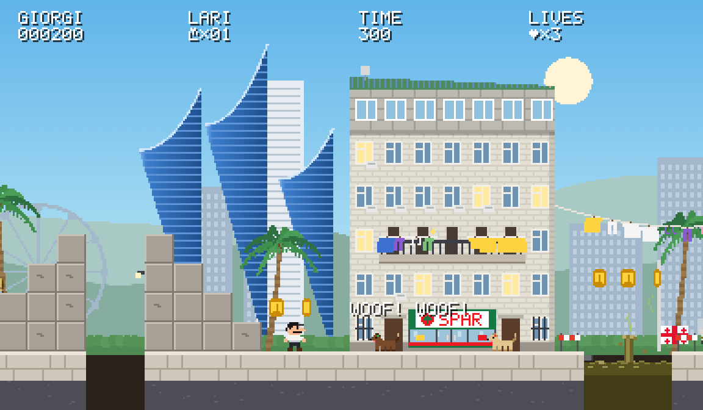
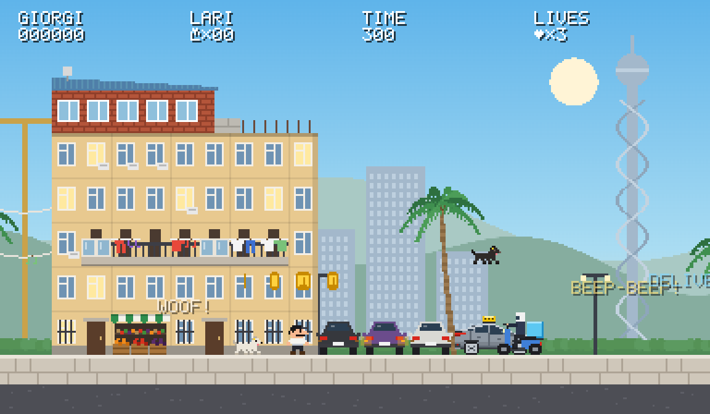
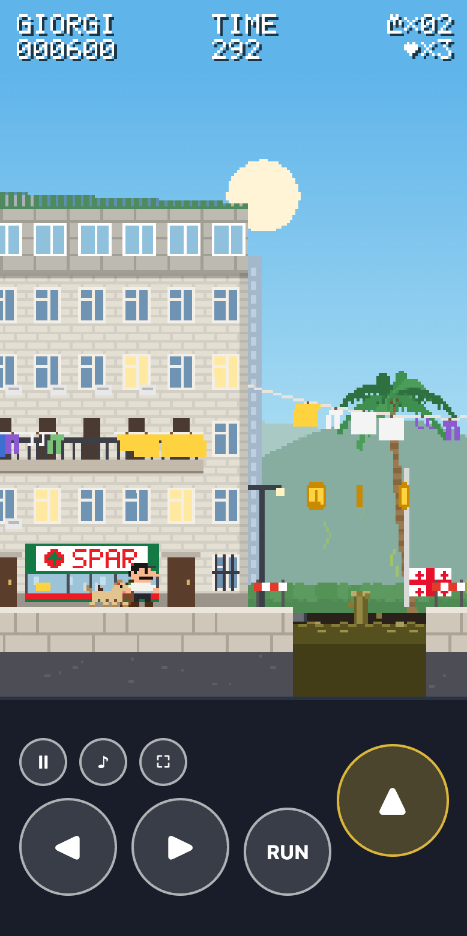
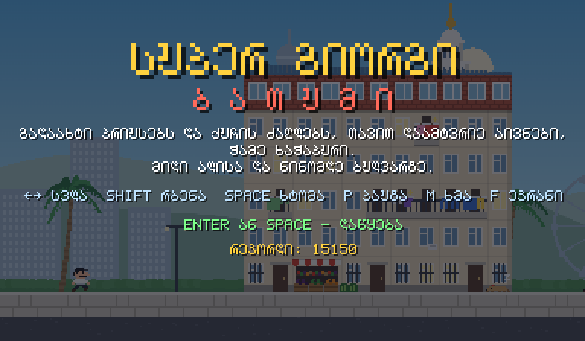

<div align="center">

# Super Giorgi: Batumi

**A parody pixel-art platformer on the streets of Batumi.**<br>
Jump over Prius taxis, make friends with stray dogs, knock balconies out with your head,
eat khachapuri and make it to Ali &amp; Nino on the seafront.

### ▶ [Play it at super.malets.by](https://super.malets.by)

Works in any modern browser, on desktop and on phones.<br>
English · Русский · ქართული



</div>

## What's in Batumi

- **Prius taxis.** Third-generation Priuses with a taxi sign on the roof. They drive at you on the pavement, honk, and the roof makes a great trampoline.
- **Delivery mopeds.** Couriers with a light-blue box on the rack, faster than the taxis.
- **Stray dogs.** Dogs in every coat, with yellow, red, blue or green ear tags. Some sleep, some patrol, and some wake up and chase you. They never hurt you and they never get hurt: land on one and it becomes your friend. A bump only knocks Giorgi back.
- **Khrushchyovkas.** Five floors, a sixth one added later in different bricks (sometimes still half built), a greengrocer or a SPAR on the ground floor, and washing lines strung between the houses.
- **Balconies.** Headbutt them like Mario's bricks. Out fall coins, khachapuri, and the occasional slipper.
- **Burst sewers.** Holes in the pavement, plus ponds of sewage with a geyser. Don't fall in.
- **The skyline.** Alphabet Tower, the Ferris wheel, Orbi City, the Sheraton and Batumi Tower in the background, the Neptune fountain on the way, and the statues of Ali and Nino waiting at the finish.
- **Music.** An original tune in 6/8 inspired by the Acharuli dance, synthesized on the fly.

<table>
  <tr>
    <td width="62%"></td>
    <td rowspan="2"></td>
  </tr>
  <tr>
    <td></td>
  </tr>
</table>

## Controls

| | Keyboard | Touch |
|---|---|---|
| Walk | ← → or A D | ◀ ▶ (slide your thumb between them) |
| Run | Shift or X | RUN |
| Jump | Space, ↑, W or Z | ▲ |
| Start / restart | Enter or Space | tap anywhere |
| Pause | P or Esc | ⏸ |
| Sound | M | ♪ |
| Full screen | F | ⛶ (on iPhone: Share → Add to Home Screen) |

On a phone held upright the game switches to its own layout: the HUD on top, a zoomed-in street, and a gamepad underneath.

## Languages

The language follows the browser. You get Georgian or Russian if one of them comes first in your settings, and English otherwise. To pick one by hand, add `?lang=en`, `?lang=ru` or `?lang=ka` to the address. All the text, Georgian letters included, is drawn with the game's own 5×7 pixel font.

## Run it locally

No build step and no dependencies. Clone the repo and open `index.html`:

```sh
git clone https://github.com/gogodzilla/super-giorgi.git
cd super-giorgi
open index.html                      # works straight from disk
# or serve it, e.g.
python3 -m http.server 8000          # → http://localhost:8000
```

## How it's made

There's one HTML page and one plain script, [`game.js`](game.js), with no framework and no image or sound assets:

- **Sprites** are pixel-art string maps in the code (Giorgi, dogs, the khachapuri). The cars and buildings are drawn with canvas rectangles.
- **The background** is pre-rendered parallax layers. They're drawn at high resolution and then shrunk with nearest-neighbour sampling, so the skyline stays as chunky as the foreground.
- **Rendering** goes into a low-resolution buffer (224 px tall) that is scaled up without smoothing. The view width follows the window, so the game fills any screen.
- **Text** uses a hand-made 5×7 bitmap font covering Latin, Cyrillic and Georgian (drawn as Mtavruli capitals).
- **Sound effects** and the backup tune are synthesized with the Web Audio API. If `music.mp3` is next to the page, it plays instead.
- **The game loop** runs at a fixed 60 Hz timestep with simple tile and rectangle collisions. The whole level is built in code.

For console tinkering, `window.__mario` exposes the game state, the player, the level and an `setAction(action, down)` helper.

[`CLAUDE.md`](CLAUDE.md) holds the detailed design notes: the architecture and the house rules (for example, dogs never die).

## Credits &amp; license

Made by [@gogodzilla](https://github.com/gogodzilla) in Batumi, built together with [Claude Code](https://claude.com/claude-code).

- **Code** is under the [MIT License](LICENSE).
- **`music.mp3`** is the author's own recording, © Maxim Malets, all rights reserved ([`LICENSE-music.txt`](LICENSE-music.txt)). It isn't covered by the MIT License.

This is a fan-made parody, not affiliated with or endorsed by Toyota, SPAR or anyone else whose name appears in the game.
